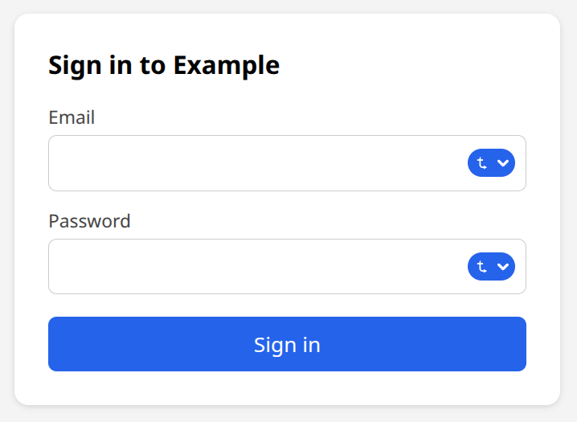
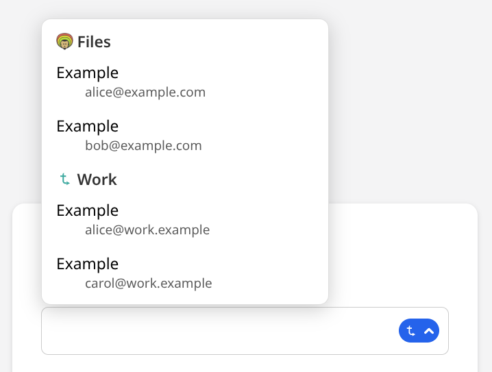
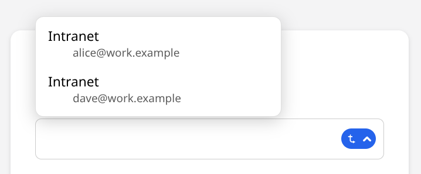
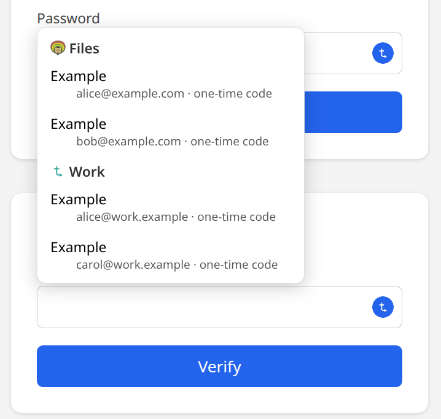
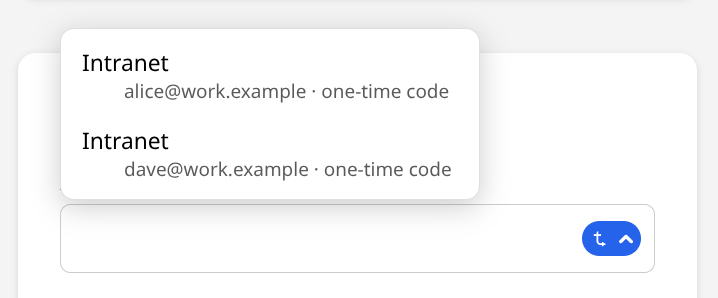

# Passwords, passkeys and two-factor codes

What the [vault](vault.md) keeps, and how each platform fills it in. A domain keeps these once its config lists `totp`, `passwords` or both in `extensions`, and its vault is [created](vault.md#creating-the-vault) and [unlocked](vault.md#unlocking-a-machine) on the machine.

| Where | Codes | Logins | Passkeys |
|---|---|---|---|
| Command line | `tsync totp` | `tsync passwords` | listed, filed with a login |
| macOS | menu bar, Safari's AutoFill (macOS 15) | [AutoFill](#autofill-on-macos) | [AutoFill](#autofill-on-macos) |
| Linux desktop | [tray](desktop.md#tray) | [Chrome extension](#in-chrome) | [Chrome extension](#in-chrome) |
| Chrome on a Mac | [extension](#in-chrome) | [extension](#in-chrome) | [extension](#in-chrome) |
| Android | [Vault screen](android.md#vault), autofill | [autofill](android.md#passwords-and-autofill) | [autofill](android.md#passwords-and-autofill) (Android 14) |

## Two-factor codes

With `totp` in `extensions`, the vault keeps the seeds of time-based two-factor codes (TOTP), the six-digit codes an authenticator app shows. tsync computes the codes; no seed ever leaves the vault, and none is printed back.

**Adding a code.** A service shows its seed as a QR code, which holds an `otpauth://totp/` link, or as text:

```bash
tsync totp add -                                          # paste the otpauth:// link on standard input
tsync totp add --secret - --issuer GitHub --account me    # the text seed, read from standard input
```

Pass `-` and paste, rather than the seed itself on the command line, so it stays out of your shell's history.

**Reading a code.**

```bash
tsync totp list               # the records: issuer, account, seconds left, id
tsync totp list github        # those whose issuer or account contains "github"
tsync totp list --show-codes  # with their current codes
tsync totp code ID            # one code
```

`list` prints no code unless you ask: a terminal's output ends up in its scrollback, a screen share, or a tool reading it.

**Moving from another authenticator.** `tsync totp import FILE` reads a plain-text export, one `otpauth://` link per line, as Ente Auth and others write it. It says how many it added, how many were already there, and why any line was refused, by line number and never by content. Importing the same file twice adds nothing.

**Moving out.** `tsync totp export` prints every record as an `otpauth://` link. It asks for the passphrase each time, even on an unlocked machine: no other way gets the seeds out.

**From the macOS menu bar.** The menu's *One-time codes* lists each record as `issuer — account`. Clicking one copies its current code, marked so clipboard managers and history skip it; the menu never shows a code itself. A locked domain shows *Locked — unlock…*, which asks for the passphrase (and the secret key on a machine not yet enrolled); *Add a code…* takes the issuer, the account and the seed, or a pasted `otpauth://` link. Each secret field has a *Show* box to see what you typed. Creating the vault, changing the passphrase, deleting and exporting stay with the command line. The Linux tray lists and copies codes, and unlocks, the same way, on Wayland; it has no *Add a code…* ([desktop](desktop.md#tray)).

**On an Android phone.** The app's *Vault* screen appears when the server's domain uses an extension; see [the Android page](android.md#vault).

`tsync totp rename ID` and `tsync totp remove ID` change or remove one record. Two machines changing the same record at once lose nothing: two renames keep the newer name, a rename and a removal keep the renamed record, and two different codes under one record are both kept, the second labelled `(conflicted copy from <machine>)` for you to remove the one you do not want.

## Passwords and passkeys

With `passwords` in `extensions`, the vault keeps your logins (a title, the sites it is for, a username, a password, notes) and your passkeys. With `totp` too, a login can carry its two-factor code.

**Adding a login.**

```bash
tsync passwords add --title GitHub --url https://github.com --username me    # asks for the password
tsync passwords add --title Bank --url https://bank.example --username me --generate 24
tsync passwords add --title GitHub --url https://github.com --username me --otpauth -
```

`--password -` reads the password from standard input; with neither `--password` nor `--generate` it is asked without echo. `--generate LENGTH` draws one (8 to 128 characters; `--no-symbols` for letters and digits only), and `--words N` one of N words (4 to 12), easier to read out and type. `tsync passwords generate` prints one without saving it, with the same options. `--url` repeats for a login used on several sites; a site is `https://host` (a port if any, no path), or `android://package` for an Android app. A login for `example.com` also serves `login.example.com`.

`--otpauth` adds a two-factor code and links it to the login; `--totp ID` links one already in the vault (`tsync totp list` gives its id), and `--totp ""` unlinks it.

**Finding and reading.**

```bash
tsync passwords list                          # titles, usernames and passkeys; never a password
tsync passwords list --site https://github.com
tsync passwords get ID                        # the password alone, on one line
tsync passwords get ID --field PIN            # one custom field's value
```

**Notes and custom fields.** A note keeps what is not a login, a door code or a recovery phrase: `tsync passwords add --note --title "Wi-Fi" --notes "…"`. Logins and notes take extra fields, `--field NAME=VALUE`, or `--secret-field NAME` to type the value without echo; on `edit`, the fields given replace the list. `get` of a note prints its notes, and `--field` one field. Notes are never offered to fill a form, and `list` shows titles, never a field.

`list` marks a login with a linked code `(code)`. `tsync passwords edit ID` changes any field (the same options as `add`), and `tsync passwords remove ID` removes a login or a passkey.

**Passkeys** are made and used by your browser or apps, through tsync's AutoFill on macOS, its Chrome extension and its autofill on Android: there is no command to create one. `list` shows them by site and user name, and `edit ID --login LOGIN_ID` files one with the login it belongs to. A passkey never leaves the vault: it signs inside tsync, and `tsync passwords export` leaves it out. A [vault export](vault.md#exporting-and-importing) carries it, sealed.

Two machines editing the same login at once keep the newer edit; a login whose password was changed on both sides keeps both, the second labelled `(conflicted copy from <machine>)`.

### AutoFill on macOS

macOS 14 and later. Turn on tsync in *System Settings → General → AutoFill & Passwords* (*Passwords → Password Options* before macOS 15); the menu bar shows *Turn on AutoFill for tsync in System Settings…* until you do.

- **Logins.** In Safari or an app, click the username field and choose tsync's suggestion, or *Other passwords…*: tsync's sheet lists the site's logins by title and username, and the one you pick is filled. Nothing is filled without a pick.
- **Two-factor codes** (macOS 15). On a site's code field, Safari offers the code of the login that links one; pick it and tsync fills the current code. For this, tsync lists `title — username` for each such site in macOS's AutoFill list, never the code or the seed.
- **Passkeys.** When a site offers to create a passkey, choose tsync: it is saved in the vault, after Touch ID when the site asks for verification. Signing in, Safari lists your tsync passkeys by user name; picking one signs in. tsync lists each passkey's site and user name in macOS's AutoFill list for this, never its key.
- **A locked vault** shows as *Files is locked — Unlock it from the tsync menu* (with your domain's name): the sheet never asks for your passphrase. Unlock from the menu bar and try again.

### Autofill on Android

See [the Android page](android.md#passwords-and-autofill).

### In Chrome

<a id="browser"></a>Chrome, Chromium, Brave, Edge or Vivaldi, on Linux or a Mac. tsync's browser extension fills logins and two-factor codes, saves new logins, suggests strong passwords, and makes and uses passkeys.

- **Setting it up.** tsync's packages let your browsers start tsync's bridge; add tsync's extension from the Chrome Web Store, which keeps it up to date. Built from source, run `tsync passwords browser install` once per user instead, after removing the package if one is installed. Its store listing is not published yet; until it is, the extension is loaded from tsync's source, `browser/` in *Developer mode* with *Load unpacked*, which is meant for development.
- **Filling.** A username, password or code field shows tsync's icon; click it, or press Ctrl+Shift+L (⌘⇧L on a Mac), and pick a login from the menu. Nothing is filled without that click. The icon's arrow shows whether the menu is open; click it again, press Escape or click elsewhere to close it. With logins in several vaults, the menu lists them under each vault's name. A login saved for `example.com`, offered on `login.example.com`, asks once before it fills.

  

   
- **Codes.** A two-factor field offers the code of each of the site's logins that links one, by username, under each vault's name when several vaults have one. The popup (tsync's toolbar icon) also copies it.

   

- **Saving.** Signing in with a password you typed asks *Save this login in tsync?*, or *Update the password* when tsync has another one for that username. *Never for this site* stops asking there.
- **A strong password.** Signing up, or changing a password, a new-password field offers *Use a strong password*: it fills a generated password, and the field confirming it, and saves the login in tsync at once; submitting the form adds the username to that login.
- **Passkeys.** A site asking to make or use a passkey shows tsync's sheet, naming the site; on Linux it asks the vault's passphrase when the site wants you verified, on a Mac Touch ID. tsync answers every passkey request, even on a site where it has none: Chrome only gets a sign-in when you pick *Use a phone or security key*, and never a new passkey.
- **A locked vault** is said in the menu and the sheets: unlock it in tsync, from the tray, the menu bar or `tsync vault unlock`.
- **Chrome's own password manager.** Installing tsync's extension turns off Chrome's offer to save passwords, and its address and card autofill, so nothing new lands in Chrome by mistake; the popup's checkbox gives them back if you want. Passwords and passkeys Chrome already saved stay in Chrome until you delete them there: export them from Chrome's password manager, `tsync passwords import` the file, then delete them in Chrome.
- **Incognito.** Chrome turns every extension off in incognito windows: allow tsync there in `chrome://extensions` → tsync → *Details* → *Allow in Incognito*, handy to try a sign-in with no cookies. It then works as in a regular window, and keeps no *Never for this site* from an incognito tab.

### Moving from a browser or another manager

`tsync passwords import FILE` reads the CSV export of a browser, Bitwarden or 1Password-style managers (columns named like `name`, `url`, `username`, `password`, `notes`, and `otpauth` or `login_totp` for two-factor seeds). It adds every row, so importing a file twice gives each login twice. The CSV is plaintext: delete it once imported. `tsync passwords export` prints every login as CSV after the passphrase; passkeys are left out, since a CSV has no place for them.
