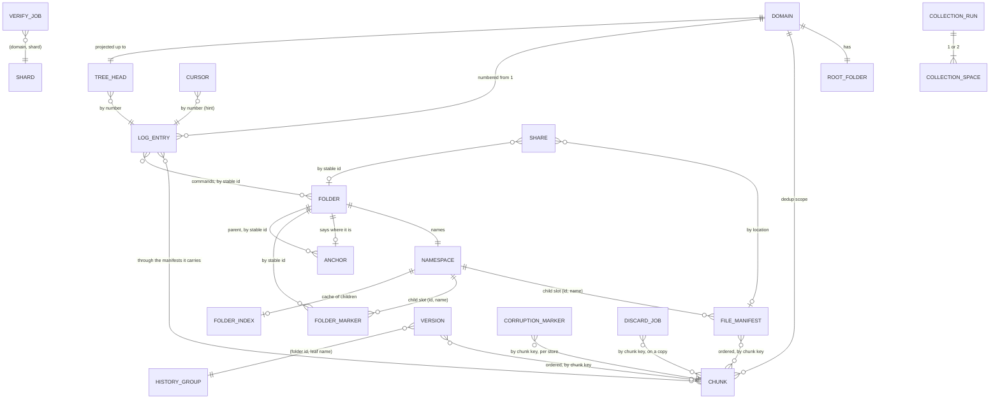

# Data model — what a domain stores on its backend

This file specifies the abstract model of the shared object store: the entities every client of a domain
reads and writes, how they relate, the invariants that hold between them, who may write what, and how
the per-object tree is projected from the log. It owns the entity lifecycles, the invariants and the
projection of an entry onto the tree.

It names no byte format or key spelling except in §9. Which stored formats are frozen (core) and which
may change (ephemeral) is stated in [02-remote-model.md](../02-remote-model.md). Byte formats and key spellings are owned by
[02-remote-model.md](../02-remote-model.md); the store contract by [06-backends.md](../06-backends.md);
retention and garbage collection by [algorithms/gc.md](../algorithms/gc.md); log, cursor and tree-head
formats by [03-journal-sync.md](../03-journal-sync.md); the protocol that creates entries and decides
who projects them by [algorithms/publication.md](../algorithms/publication.md); local state by
[local-cache.md](local-cache.md). Implementation notes: [ocaml/data-model/backend.md](../ocaml/data-model/backend.md).

---

## 1. Purpose and the medium

**Purpose.** Hold one user tree (a *domain*) so that any number of clients can lazily read it, write it
concurrently, rename folders cheaply, keep history and reclaim space, with no server logic beyond the
store itself and an optional bucket function (integrity checks and queued deletes).

**What the medium offers** (the full contract is [06-backends.md](../06-backends.md)):

- Named objects with opaque byte bodies; each write is **atomically visible** (absent or whole).
- Read whole, read a byte range, existence probe with size, modification time and (usually) an entity
  tag, delete (single and batched), server-side copy.
- Listing by name prefix.
- **One arbitration primitive: create-if-absent**, answering the body that holds the name afterwards.
  Nothing else arbitrates: in particular, whether a delete reports that the object existed MUST NOT be
  used to decide between clients.
- On a filesystem store only: rename within the tree, and host-level advisory locks.

**What it lacks.** No multi-object transaction, no compare-and-swap on an existing object, no ordering
or snapshot guarantee across listings, no server-side triggers except object-created notifications to
the bucket function, and a rate limit on repeated writes to one name (about one per second). A
conditional delete (delete only the version read) is available on some stores and MUST NOT be relied
on for correctness.

**Who shares it.** Every client of the domain (desktop owners, mobile apps, one-shot commands acting
through or as an owner), http-proxy servers re-exporting a store, the collector (on the host that owns
a filesystem main), the bucket function (per object store), and share servers. They never talk to
each other; the store is the only channel, and the log on the main is the only place where a change to
the tree is decided.

**Scope of one layout.** One domain is one abstract layout. A physical store may hold many domains side
by side; a domain may be spread over several stores (*members*), each holding a copy of the same layout
at a different degree of completeness (§5.3).

---

## 2. Entities

*Identity* is what makes two instances the same object. *Mutability* is one of **immutable**,
**replaced whole** (last writer wins), **create-if-absent** (first writer wins) or **appended** (new
objects added, existing ones immutable).

### 2.1 Domain

- **Represents** one synchronised tree and everything needed to operate it.
- **Identity** its name, unique within a store, following the domain-name grammar of
  [01-core.md](../01-core.md) (which excludes the reserved sibling-tree names of §5.4).
- **Attributes** none stored. Configuration (members, roles, chunk size, versioning) is local to each
  client and MAY differ between clients.
- **Lifecycle** exists once any object under it exists. Dropping a domain MUST delete its own tree, its
  entries in the three sibling trees of §5.4 and every share naming it (§2.18).

### 2.2 Chunk

- **Represents** a contiguous slice of a regular file's bytes.
- **Identity** its chunk key, a 128-bit non-cryptographic digest of its bytes
  ([01-core.md](../01-core.md), chunk keys). Two chunks with equal bytes are the same chunk. Any reader
  can check a chunk against its key; the check detects accidental damage, not a forged body (threat
  model: [algorithms/security-model.md](../algorithms/security-model.md)).
- **Attributes** the bytes; the length is implicit.
- **Mutability** immutable in meaning; a re-put writes the same bytes and refreshes the object's
  modification time.
- **Cardinality** one per distinct slice content **per domain** (the dedup scope is the domain). The
  empty body is a chunk: every empty regular file names it.
- **Lifecycle** created by an uploading client before any manifest names it. Never updated. Deleted only
  by a collection ([algorithms/gc.md](../algorithms/gc.md)): directly on the collected main, by queued
  or direct delete on copies.

### 2.3 File manifest

- **Represents** the current content of one regular file or symlink at one place in the tree.
- **Identity** its **location**: (containing folder id, leaf name).
- **Attributes** logical size, modification time, the chunk size used to cut it, the ordered list of chunk
  keys (index *i* covers bytes `[i·chunk_size, …)`), a whole-file digest derived from the ordered chunk
  keys and lengths, the leaf name recorded at write time, and for a symlink its target and no chunks.
- **Mutability** replaced whole, only by a projection (§6). The value of a file at a place is decided
  by the log ([algorithms/publication.md](../algorithms/publication.md)); the manifest object is that
  value made readable without the log.
- **Recorded name** informational; the location is authoritative. It exists because places a manifest
  body is copied to (versions, share, cache) cannot yield the name back, and because a namespace
  listing yields only a hash of the leaf. A projection writes it from the key's leaf. A reader that has
  the location MUST use the location's leaf.
- **Lifecycle** created, replaced or deleted when a projection applies a command on its location. A
  file rename is two commands: a deletion at the old location and a creation at the new one, with the
  same content. Prior bodies survive as versions when versioning is on.

### 2.4 Folder

- **Represents** a directory, independent of where it sits.
- **Identity** a **stable folder id** (grammar: [01-core.md §2.5](../01-core.md#25-folder-ids)): minted
  by the client that creates the folder
  ([03-journal-sync.md §2.1](../03-journal-sync.md#21-client-identity-and-folder-id-leases-local)), final
  from the mint. Never reused and never changed; it survives rename and move.
- **Attributes** none of its own; it names one **namespace** (§2.5) and is the subject of one **anchor**
  (§2.7).
- **Reserved id** the **root** (the domain's top folder: no marker, no anchor, always exists).
- **Lifecycle** exists from the entry that creates it to the entry that removes it. A removal is
  committed only when the folder is empty in the main's tree, so nothing remains in its namespace.

### 2.5 Namespace

- **Represents** the set of direct children of one folder, file manifests and folder markers, plus the
  folder's own anchor and folder index.
- **Identity** the folder id. The namespace is not an object: it is the set of objects sharing the id.
  Listing it is the authoritative way to learn a folder's children.
- **Child slot** (folder id, leaf name). A file and a folder of the same name in the same folder share
  one child slot; the object there is one or the other, classified by its body.

### 2.6 Folder marker

- **Represents** "the folder with id *I* appears in folder *P* under name *N*".
- **Identity** its child slot (*P*, *N*).
- **Attributes** *I* and *N*.
- **Mutability** replaced whole, only by a projection (§6).
- **Validity** a marker whose id is empty or not a folder id is **unclassifiable**: readers
  skip it as a write in flight.
- **Lifecycle** written when a projection places a folder at that slot; deleted by the projection that
  moves the folder away or removes it.

### 2.7 Anchor

- **Represents** where a folder is: (parent id, name). It is the per-object record of the folder's
  value in the main's tree.
- **Identity** the folder id (exactly one per folder, stored inside the folder's own namespace).
- **Mutability** replaced whole, only by a projection (§6).
- **Role** it settles which marker is current while a projection is in progress (§6.2). A marker at
  (*P*, *N*) naming *I* is **filed** iff anchor(*I*) = (*P*, *N*). Otherwise it is **disowned** and
  every reader treats it as absent. A marker whose folder has no anchor is disowned.
- **Lifecycle** written before the marker it validates; deleted last when the folder is removed.

### 2.8 Log entry

- **Represents** one batch of commands a client committed: for each key it changes, the value before
  and the value after ([algorithms/change-algebra.md](../algorithms/change-algebra.md) Definition 6).
- **Identity** its number. Numbers are dense from 1; the highest is the **head**.
- **Attributes** the author's client id; the commands. A file's value after is its whole manifest, so
  an entry references chunks and nothing else.
- **Mutability** **create-if-absent**, then immutable. This is the one arbitration between clients: at
  most one entry holds a number.
- **Lifecycle** created by a push
  ([algorithms/publication.md §4.5](../algorithms/publication.md#45-push)), after every chunk it names
  is on the main; deleted by expiry as
  [algorithms/publication.md §4.9](../algorithms/publication.md#49-log-retention) allows.

### 2.9 Version

- **Represents** a previous body of a file manifest.
- **Identity** (history group, timestamp). The **history group** is the manifest's location, so history
  follows a folder rename but not a file rename: a file rename leaves the old name's history as a
  deleted file, restorable under that name. (A rename costs one object; carrying history along would
  cost one copy per version.)
- **Timestamp** nanoseconds since the epoch. A writer MUST make the timestamps it creates for one history
  group strictly increasing, so two snapshots never share a key.
- **Attributes** the old manifest body verbatim (hence the recorded name of a deleted file).
- **Mutability** immutable; **appended** per group.
- **Lifecycle** created, when versioning is on, by a projection immediately before it replaces or
  deletes a manifest. The snapshot is best effort: a failed snapshot MUST NOT block the projection, and
  MUST be logged. Deleted by expiry by age.
- **Derived notion** a *deleted file* is a history group with versions and no live manifest at its
  location.

### 2.10 Tree head and takeover

- **Tree head** one per domain: the number of the last entry whose commands are all applied to the
  per-object records. **Mutability** replaced whole, raised only, by the projector of that entry.
- **Takeover** one per (entry, generation): names the client that may project an entry its previous
  projector left unprojected. **Mutability** create-if-absent.
- **Void** at most one per entry: makes an entry that does not decode read as empty. Created by an
  operator, create-if-absent; stored and kept with the entry's takeovers.
- **Role, lifecycle** [algorithms/publication.md §4.6](../algorithms/publication.md#46-projection-the-tree-follows-the-log).

### 2.11 Cursor

- **Represents** a hint: "the head was *n* when some writer last looked".
- **Identity** one per domain. **Mutability** replaced whole, debounced; it may move backwards or be lost.
- **Role** lets idle readers watch one object; correctness never depends on it. Also the object the write
  guard probes to learn whether the main is reachable. Owned by [03-journal-sync.md](../03-journal-sync.md).

### 2.12 Folder index

- **Represents** a cache of a namespace's child bodies, each tagged with the entity tag the store
  reported for that child.
- **Identity** the folder id. **Mutability** replaced whole, written only by full walkers allowed to write.
- **Validity** an entry counts only if the live listing reports the same tag for that child; otherwise
  the child is read. It is meaningful only on the store whose tags it recorded, and MUST be neither read
  nor written for a domain with more than one readable member.
- **Lifecycle** rewritten when its coverage falls below a threshold; deleted when its folder is removed.
  Nothing on the write path maintains it.

### 2.13 Collection run

- **Represents** an open chunk collection on one collectable main: phase, start time, and a progress
  cursor (last finished unit, by name).
- **Identity** one per domain per collectable main; it lives on that main only, never on copies.
- **Mutability** replaced whole; the phase is recorded before the step it names.
- **Effect on readers** its **presence**, whatever its body, means chunks may live in either of two
  collection spaces (§2.14).
- **Generation** a counter beside it on the collectable main, persisting across runs: odd while a
  collection's deletions on copies are in flight, even once they settled. Memos of chunks present on a
  copy are tagged with it ([algorithms/gc.md §5.6](../algorithms/gc.md#56-the-generation-and-presence-memos)).
- **Lifecycle and exclusion** [algorithms/gc.md](../algorithms/gc.md).

### 2.14 Collection space

- **Represents** a named set of chunks. Normally one, the *surviving* space. During a run, also the
  *outgoing* space: everything that existed when the run opened and has not yet been proven live.
- **Identity** (domain, space). A chunk's identity does not depend on which space holds it.
- **Lifecycle** [algorithms/gc.md](../algorithms/gc.md).

### 2.15 Corruption marker

- **Represents** "this store's copy of chunk *C* is bad": wrong bytes (with the computed digest and size)
  or unreadable (with a reason), and a time.
- **Identity** (domain, chunk key) **per store**: it describes the bytes of the store it sits on.
- **Mutability** replaced whole. Its existence is the finding; the body is optional detail, and an
  unparseable body is still a marker.
- **Lifecycle** filed by a store's own checker (the local driver after a verified write, the bucket
  function on chunk creation and verify jobs) and by a verifying collection. Cleared by a good rewrite of
  the chunk (the checker deletes the marker before re-checking) and by a collection that deletes the
  chunk.
- **Effect** an uploader MUST NOT deduplicate against a chunk marked on any member it reads: it re-sends
  the bytes.

### 2.16 Verify job

- **Represents** a request to a store's bucket function: check every chunk of one shard of one domain.
- **Identity** (domain, shard). **Lifecycle** created by an integrity verification; deleted by the function
  after the shard is done (last, so a crashed check leaves evidence). Findings are corruption markers.

### 2.17 Discard job

- **Represents** a request, placed on a copy that supports queued deletion, to delete a list of chunks
  and their corruption markers.
- **Identity** (domain, collection run, last shard of the batch). The run in the identity keeps a later
  collection from overwriting an unconsumed request.
- **Lifecycle** written when a collection's delete reaches that copy; consumed and deleted by the bucket
  function, which leaves it in place if it refused any key. Execution rules (re-checks, re-delivery):
  [algorithms/gc.md](../algorithms/gc.md).

### 2.18 Share

- **Represents** a public, expiring link to one file or one folder.
- **Identity** a random token. Shares are **not** scoped by domain on the store (one shared tree per
  store, so IAM rules and lifecycle rules take one literal prefix); the body names its domain.
- **Attributes** format version, domain, expiry time, type, display filename, and a reference: for a file
  the manifest's **stored location**, for a folder its **folder id**.
- **Placement** on one member of the domain (the first readable member advertising a share endpoint),
  written directly, not through the composite. A share is not replicated: it exists only on the store
  that holds it.
- **Validity** a reader MUST refuse a share whose domain is not a valid domain name, whose file reference
  lies outside that domain's manifest area, or whose folder reference is not a valid folder id, and MUST
  refuse a share past its expiry.
- **Lifecycle** created by the share operation ([05-ops-config.md](../05-ops-config.md)); deleted by
  expiry once expired ([algorithms/gc.md](../algorithms/gc.md)) and when its domain is dropped.
- **Referent** a folder share follows the folder by id through moves and renames, and stops serving
  once the folder is removed. A file share follows the manifest's location: it stops serving after a
  rename or delete of the file, and follows a rename of a containing folder.

### 2.19 Share artifact cache

- **Represents** assembled bytes a share server built: a whole file, or a folder archive; and a share's
  preview image, made by its creator or a share server.
- **Identity** a file served by content: the whole-file digest; a download of a share, or its preview
  image: the token.
- **Derived** entirely from chunks and manifests. A token-keyed folder archive MUST be rebuilt once older
  than `share_archive_max_age` (recommended 1 hour), so a folder share does not serve a frozen snapshot
  forever. Dropped whole by the clear-cache operation; token-keyed artifacts of deleted shares are
  deleted with them. A preview image is not deleted by age, since only a host with a thumbnailer can
  make it again; without it a link's preview falls back to the generic image.

### 2.20 Deferred debt (not a store object)

What a replica or backfill member owes relative to the main is recorded client-side, per (domain,
member), as an ordered durable log of **bodyless** jobs: put *key*, copy *src→dst*, delete *keys*. The
job names what changed; bodies are re-read from the main at execution time. It is the only record of
how a copy differs from the main; it is not replicated and not visible to other clients. Owned by
[algorithms/replication.md](../algorithms/replication.md).

---

## 3. Relations

| From → to | By | A dangling reference means | Readers MUST |
|---|---|---|---|
| manifest / version / log entry → chunk | chunk key | A copy behind its debt, or a violated invariant (§4.1) | fail the read with "missing"; never substitute bytes |
| marker → folder | stable id | The namespace may be empty (a new folder): legal | list it as an empty folder |
| marker → anchor | stable id | A projection in progress, or a marker a lost delete left | treat the marker as absent |
| tree head → log entry | number | Entry expired | nothing: the tree stands for it |
| cursor → log entry | number | Stale hint | ignore it |
| share → manifest location | (folder id, leaf) | File renamed or deleted | answer "not found" |
| share → folder id | stable id | Folder removed | answer "not found" |
| folder index entry → child | location + tag | Tag mismatch or child gone | ignore the entry |
| corruption marker → chunk | chunk key | Chunk gone: the marker is stale | ignore it |
| discard job → chunk | chunk key | Chunk already gone | treat the delete as done |

The **path of a file** is not stored anywhere as a unit: it is the chain root → marker → … → manifest
location, resolved by one read per segment, each segment validated by the target folder's anchor. Only
share filenames record names, for display.

---

## 4. Invariants

### 4.1 At rest (after every writer has finished and every debt is paid)

1. **Referential completeness.** Every chunk named by a manifest or a version exists (in either
   collection space during a run) on every member that holds that referrer, and every chunk named by
   a log entry above the tree head exists on the main.
2. **Content identity.** A chunk's bytes hash to its key, except where a corruption marker on that store
   says otherwise.
3. **The log is dense.** The retained entries have consecutive numbers up to the head, and every tree
   $M_n$ they define is well-formed
   ([algorithms/change-algebra.md](../algorithms/change-algebra.md) Proposition 6).
4. **The tree is the log's.** With the tree head at the head, the per-object records are exactly the
   head's tree: one manifest per present file, one anchor and one filed marker per present folder, and
   nothing else in the manifest area but folder indexes.
5. **One placement per folder, one occupant per child slot.** A consequence of 3 and 4.
6. **Cursor names an entry that exists**, or is absent.
7. **Collection closure.** With no run open there is exactly one collection space. With a run open, every
   chunk named by a manifest or version that marking has passed, by an entry marking has passed, or by
   a write that went through the collection interlock since the run opened, is in the surviving space.
8. **Copies never hold unverifiable state.** A copy is written only while the main is reachable, and
   receives only what the main already took.
9. **Copy file completeness.** A manifest reaches a replica only after every chunk it
   names is confirmed there ("partial coverage, never partial files").

### 4.2 Temporarily violated, and who repairs

| Violation | Arises from | Repaired by |
|---|---|---|
| Orphan chunks (nothing names them) | an upload whose commit has not happened yet, or never will; deletions and expiry | the commit names them; otherwise the next collection |
| Tree behind the log (tree head below the head) | always, between a commit and the end of its projection | the entry's projector; another client after the settle ([algorithms/publication.md §4.6](../algorithms/publication.md#46-projection-the-tree-follows-the-log)) |
| A record ahead of the tree head | a projection in progress | the projection's end; a state read replays the log over it |
| Disowned marker still present | a projection between its anchor write and its marker writes; a lost delete | the projection's end; after a lost delete the marker stays, invisible, and the tree report names it |
| Folder with an anchor and no filed marker | a projection between two of its steps | the projection's end |
| Chunk in the outgoing space while referenced | a run between its open and the marking of that referrer | marking, or the interlock's promotion before the reference is published |
| Copy behind the main | always, by design | the member's deferred job log |
| Folder index stale | any child write | readers validate per entry; the next full walk rewrites it |
| Corruption marker for a good chunk | a spurious finding, or a rewrite not yet re-checked | re-verification |

### 4.3 Ordering rules (crash consistency)

The atomicity unit is one object. Every multi-object change MUST be ordered so that a crash at any point
leaves the old state, the new state, or a state readers classify safely.

1. **Referent before referrer.** Chunks before the log entry that names them; the log entry before any
   tree record it gives a value to; the tree records of an entry before the tree head names it; the
   entry before the cursor names it. This holds on every member and for every writer, including
   member-to-member mirror and repair: a manifest is never written to a store before
   every chunk it names is present there, and a log entry is never created on the main before them.
2. **Interlock before reference.** On a collectable main, a log entry, a manifest or a version becomes
   visible only through the collection interlock ([algorithms/gc.md](../algorithms/gc.md)).
3. **Authority before evidence.** A folder's anchor is written before the marker it validates.
4. **Old version before overwrite.** The version snapshot is taken before a manifest is replaced or
   deleted.
5. **State before step.** A collection records its phase before performing it, and its progress after
   each finished unit; every step is idempotent.
6. **Deletes owed to copies are durable before the main discards.** A collection records each copy's
   deletes durably before removing the chunks from the main, so a crash repeats deletes rather than
   leaking them.

---

## 5. Ownership and concurrency

### 5.1 Writers per entity

| Entity | Writers | Arbitration |
|---|---|---|
| Chunk | any client (uploads), deferred workers (copies), integrity repair (one member) | none needed: same name, same bytes |
| Chunk deletion | a collection only | the collection interlock on the collected main ([algorithms/gc.md](../algorithms/gc.md)) |
| Log entry | any client, from the head | **create-if-absent**: one entry per number |
| File manifest, folder marker, anchor | the projector of the entry that changes them | one projector per entry ([algorithms/publication.md §4.6](../algorithms/publication.md#46-projection-the-tree-follows-the-log)) |
| Tree head | the projector of the entry it names | the same |
| Takeover | a client that saw an entry stay unprojected | **create-if-absent** |
| Void | an operator, for an entry that does not decode | **create-if-absent** |
| Version | the projector replacing or deleting a manifest | unique increasing timestamp per group |
| Cursor | any committing client | last writer wins, debounced |
| Folder index | full walkers allowed to write | last writer wins; validated per entry at read |
| Collection run, spaces | the collector on the main's host | [algorithms/gc.md](../algorithms/gc.md) |
| Corruption marker | the store's checker, a verifying collection | the checker deletes before re-checking |
| Verify / discard job | the requesting client; the bucket function consumes it | identity includes shard (and run) |
| Share, share cache | the sharing client; share servers | unique token; the cache is rebuildable |

### 5.2 What readers may observe mid-change

- An object mid-write is absent or whole. A child that is listed but unparseable is a write in flight:
  readers skip it rather than fail, except the collector, which stops rather than risk a discard.
- A child listed but gone on read is a *permanent* miss for that child. A deleter MUST NOT take it as the
  absence of the whole folder.
- The tree may be behind the log, and some of its records ahead of the tree head. A reader that needs
  the main's tree at a known position takes a state read
  ([algorithms/publication.md §4.7](../algorithms/publication.md#47-state-read-and-arrival-by-state)). A
  reader that serves one item (a share server, a path lookup) takes the records as they are, with the
  anchor rule of §6.2.
- During a run, a chunk may be in either space. The collected main's driver scopes every chunk access:
  it looks in the surviving space, then the outgoing one, and re-checks the run's presence before answering
  "absent"; a server re-exporting that main (an http-proxy) inherits this through the driver
  ([algorithms/gc.md §5.8](../algorithms/gc.md#58-chunk-access-is-scoped-by-the-driver)).
- A manifest may name chunks a copy does not yet hold. A reader fails over to a copy only for chunks,
  and only when the main is unreachable, never because of a miss on a reachable main.

### 5.3 Members: main, replicas, backfills, archives

All members of a domain hold the same abstract layout; they differ in what they carry and how current it
is. Roles, the composite and deferred work are owned by [algorithms/replication.md](../algorithms/replication.md).

| Member | Written | Read | Carries |
|---|---|---|---|
| **main** (at most 1) | every write, synchronously | every read; a miss there is authoritative | everything; a collectable main also carries its run and outgoing space |
| **replica** | every write, deferred through the durable job log | chunks only, and only when the main is unreachable | everything except folder indexes and collection state; a lagging subset of the main, possibly with extra chunks (deletes not yet applied) |
| **backfill** | as a replica | never | the tree and its content: no log, tree head, takeover or cursor, and no indexes |
| **archive** (read-only) | never | chunks on a miss of the main or when it is unreachable; everything in a domain with no main | different content (a frozen or foreign copy of the layout) |

Consequences:

- **Per-member entities.** Corruption markers, verify jobs, discard jobs, shares and collection state
  describe one store and live on it.
- **Copies re-read from the main only**, so a stale body is never propagated from another copy.
- **Nothing a copy holds decides anything.** A copy's log and tree lag the main's and are not a
  snapshot of it; no fetch, state read or push is answered by a copy.
- **Write guard.** A copy is never written directly (mirror, repair, verify, share) while the main is
  unreachable.
- **Mirror** (member to member) is additive: it copies what the destination lacks or holds at a
  different size, never deletes, excludes indexes and collection state, and obeys §4.3 rule 1 (chunks
  before what names them).

### 5.4 Multi-domain

- **Dedup scope is the domain.** Identical chunks in two domains are stored twice, so a domain can be
  dropped by prefix without reference counting across domains.
- **Siblings, not children.** Corruption markers, verify jobs and discard jobs are keyed by domain name in
  trees beside the domain trees (so the bucket function and lifecycle rules can target each by one
  prefix); shares are one store-wide tree. The names of those trees are reserved and are not valid domain
  names ([01-core.md](../01-core.md)).

---

## 6. Projecting an entry onto the tree

The tree is written only by projections. Which client projects an entry, the lease it works under and
the takeover of an entry its projector left are owned by
[algorithms/publication.md §4.6](../algorithms/publication.md#46-projection-the-tree-follows-the-log).
This section owns what applying an entry writes.

### 6.1 Apply

To apply an entry, its projector sets each key of the entry to its value after, in four passes over the
entry's commands. A pass ends before the next one starts.

1. **Clear what leaves.**
   - A file command whose value after is ∅: if the slot holds a manifest, save it as a version when
     its content identity is the command's value before, then delete it. A slot holding anything else,
     or nothing, is left.
   - A folder command whose value before is a place (a move or a removal): if the slot at that place
     holds a marker naming this folder, delete it. A slot holding anything else is left.
2. **Anchor what arrives or moves.** A folder command whose value after is a place: write the folder's
   anchor with that place.
3. **Fill.**
   - A file command whose value after is a manifest: if the slot holds a manifest whose content
     identity is the command's value before, save it as a version; put the manifest.
   - A folder command whose value after is a place: put the marker at that slot.
4. **Forget what is removed.** A folder command whose value after is ∅: delete the folder's index, then
   its anchor.

Then the projector raises the tree head to the entry's number.

- **Reads.** A slot is read only where what it holds decides a write: always in pass 1, and in pass 3
  for a file command that can save a version. A file command that can save none, because its value
  before is ∅ or versioning is off, is put without a read. A slot is read once in a pass:
  the body read is the one tested and the one saved as a version. It is read after the pass before
  has ended and before any write of its own pass. The slots of a pass MAY be read together
  ([06 §5](../06-backends.md#5-process-wide-services), batched reads).
- **No order within a pass.** The commands of one pass write distinct records: a batch names each key
  once, and neither the tree before it nor the tree after it holds two things at one place. Their
  writes MAY be issued in parallel, at most `PROJECT_WIDTH` at a time
  ([publication.md §7](../algorithms/publication.md#7-parameters)). The writes of one command keep
  their order: the version is saved before the slot is deleted or replaced, and a folder's index is
  deleted before its anchor.
- **Nothing else writes these records.** One projector applies the entry (publication §4.6), so a slot
  changes between its read and its write only by this projector's own passes, which is why the read
  need not be the request just before the write.
- **Idempotent.** Each pass tests what the slot holds before it deletes, and the passes after it only
  overwrite. Applying an entry again from its start, after any of its writes that its passes allow, ends
  in the same records and saves no second version: a slot already at its value after no longer has the
  identity of the value before.
- **No ordering between keys is needed.** A batch is a set, and a slot is overwritten whole. Two folders
  that swap names lose both markers in pass 1 and gain them in pass 3. The order and the temporary
  places of Theorem 3 are for a tree that must be well-formed after each change, which these records
  need not be: §6.2 and the replay of a state read
  ([publication.md §4.7](../algorithms/publication.md#47-state-read-and-arrival-by-state)) say what a
  reader finds between two writes.
- **Manifests and versions pass the reference gate** on a collectable main
  ([algorithms/gc.md §5.4](../algorithms/gc.md#54-the-collection-interlock)). The entry passed it at its
  commit, so the chunks are present.
- **Plain writes.** No projection step is conditional. One projector per entry is what makes that
  safe.

### 6.2 What readers see mid-projection

A marker at (*P*, *N*) naming *I* is **filed** iff anchor(*I*) = (*P*, *N*). It is **disowned**
otherwise, and every reader (tree walk, path lookup, state read, integrity, share servers) MUST treat it
as absent. At most one marker per folder is filed at any time, whatever deletes were lost.

| Point reached in a move | A reader walking from root sees |
|---|---|
| before pass 1 | the folder at the old place |
| old marker deleted, anchor not yet rewritten | the folder **nowhere**; its content intact, reachable by id |
| anchor rewritten, new marker not yet | the same |
| new marker written | the folder at the new place |

A path lookup by segment follows the same rule. A client holding the id keeps reaching the folder's
content through it at every point: ids, not paths, are what frontends and commands keep.

### 6.3 What a store must guarantee

1. **Create-if-absent, linearizable per name**, returning the body that holds the name afterwards, or an
   honest refusal. It is used for log entries and takeovers. On a store that refuses it, a push fails
   REFUSED and is reported: an entry is never created with a plain put. A transient failure is retried.
   (Every supported driver arbitrates; an S3-compatible endpoint is checked for it,
   [backends/s3.md](../backends/s3.md).)
2. **Atomic visibility** of each object write.
3. **Read-after-write per object** (listings may lag).
4. Plain put and delete.

---

## 7. Derived vs authoritative

| Entity | Status | Rebuilt from |
|---|---|---|
| Chunk, version | **authoritative** | — |
| Log entry | **authoritative**: the log decides the tree | — |
| File manifest, folder marker, anchor | projection of the log; the only record of the entries expiry has deleted | the log, for the entries still retained |
| Tree head, takeover | bookkeeping of the projection | — |
| Cursor | hint | the head |
| Folder index | cache | namespace listing and child reads |
| Whole-file digest in a manifest | derived | its chunk keys and lengths |
| Recorded name in a manifest | derived: written from the key's leaf by the projection | its location |
| Collection run | authoritative about a run in progress | — |
| Corruption marker | authoritative finding until re-checked | re-verification |
| Verify / discard job | request | re-issued by the client |
| Share | authoritative | — |
| Share artifact cache | cache | chunks and manifests |
| Deferred debt (local) | authoritative for what a copy owes; lost debt degrades the copy | a full mirror from the main |

---

## 8. Growth and reclamation

Every entity that grows has a reclaiming path. Rules: [algorithms/gc.md](../algorithms/gc.md).

| Grows with | Reclaimed by |
|---|---|
| Chunks | a collection on a collectable main, which also deletes on copies; expiry removes the references that make chunks garbage. A domain with no collectable main is not collected. |
| Manifests, markers and anchors | user deletes, through the log |
| Versions | expiry by age |
| Log entries | expiry by age, at or below the tree head ([algorithms/publication.md §4.9](../algorithms/publication.md#49-log-retention)) |
| Takeovers | deleted once the tree head has passed their entry |
| Folder indexes | one per namespace, capped in children and size; deleted with the folder |
| Corruption markers | good rewrites; collections that delete the chunk |
| Verify jobs | consumed; at most one per shard per domain per store |
| Discard jobs | consumed; re-delivered by the client when outstanding |
| Shares | expiry deletes expired shares of the domain; a domain drop deletes all of its shares |
| Share artifact cache | age rule of §2.19; deleted with its share; clear-cache |
| Disowned markers | the projection's end |

---

## 9. Mapping to the concrete encoding

This is the only place concrete names appear; every spelling is specified in
[02-remote-model.md](../02-remote-model.md). `D` = domain name, `sss` = the first three hex characters
of a chunk key.

| Abstract entity | Concrete representation |
|---|---|
| Domain scope | prefix `tsync/D/`, plus the sibling trees below |
| Chunk | `tsync/D/chunks/sss/<chunk key>` |
| Folder id | [01-core.md §2.5](../01-core.md#25-folder-ids); reserved `.tsync-root` |
| Namespace | prefix `tsync/D/manifests/<folder id>/` |
| Child slot | `tsync/D/manifests/<folder id>/<dual hash of leaf name>` |
| File manifest | binary `tsyncm03` body at the child slot |
| Folder marker | JSON `{"dir":true,"name","id"}` at the child slot |
| Anchor | JSON `{"parent","name"}` at `…/manifests/<folder id>/.tsync-parent` |
| Folder index | binary `tsyncidx1` at `…/manifests/<folder id>/.tsync-index` |
| Version | manifest body at `tsync/D/versions/<folder id>/<leaf hash>/<ns>` |
| Log entry | JSON at `tsync/D/log/<group>/<number>` ([03-journal-sync.md](../03-journal-sync.md)) |
| Tree head, takeover | `tsync/D/tree-head`, `tsync/D/log-takeover/<number>-<generation>` |
| Cursor | `tsync/D/cursor` |
| Collection run | JSON at `tsync/D/gc-run`; lock files `gc-run.lock` and `gc-publish.lock` beside it (filesystem only, not store objects) |
| Collection generation | JSON at `tsync/D/gc-generation` |
| Collection spaces | surviving `tsync/D/chunks/`, outgoing `tsync/D/chunks.from/` |
| Corruption marker | JSON at `tsync/corrupted/D/sss/<chunk key>` |
| Verify job | empty object at `tsync/verify-jobs/D/sss` |
| Discard job | newline-separated keys at `tsync/gc-jobs/D/<run>/<last shard>` |
| Share | JSON at `tsync/shares/<token>` |
| Share artifact cache | `tsync/shares/cache/<token>.data`, `tsync/shares/cache/<h1>-<h2>.data` |
| Internal-name sentinel | every internal leaf starts `.tsync-` |

---

## 10. Conformance

An implementation MUST exhibit these observable properties:

- **One entry per number.** Any number of clients creating one entry number concurrently end with
  exactly one entry at that number, and every client is told whether it is its own. On a store that
  refuses create-if-absent, a push fails REFUSED and no entry is written.
- **The tree is the log's.** After any sequence of commits, with the tree head at the head, a walk of
  the tree equals the tree the log defines: names, kinds, folder ids and contents.
- **Apply is idempotent.** A projection killed between any two of its writes and applied again from its
  start ends in the same records and the same versions as one that ran once.
- **Anchors decide.** A marker whose folder's anchor names another place, or whose folder has no anchor,
  is invisible to tree walks, path lookups, state reads and share servers. After a move whose old-marker
  delete was lost, the folder is listed at the new place only.
- **Swaps.** An entry that swaps two folders' names, or puts a folder where a file was and the file
  elsewhere, is applied with no intermediate name and leaves no stale record.
- **Readers.** A child listed but unparseable is skipped by walkers and stops a collection; a child
  listed but gone fails a deleter's walk.
- **Ordering.** A crash injected between any two object writes of a commit, a projection or a
  collection step leaves a state that the readers above classify as the old state, the new state, or a
  documented temporary violation (§4.2).
- **Deletes never collect chunks.** Removing a file or folder removes manifests, markers and anchors
  only; chunks stay until a collection.
- **Removed folders are empty.** A folder removal is committed only for a folder with no child in the
  main's tree; after its projection its namespace holds nothing.
- **Tree integrity.** An integrity pass reports a folder with an
  anchor and no filed marker, a disowned marker, and a record the log at the tree head does not account
  for, each only when the tree head is at the head. Repair rewrites the records from the retained log
  and removes disowned markers.
- **Shares.** A share naming a key outside its domain's manifest area, an invalid folder id or an
  invalid domain is refused; an expired share is refused and deleted by the next expiry of its domain.
