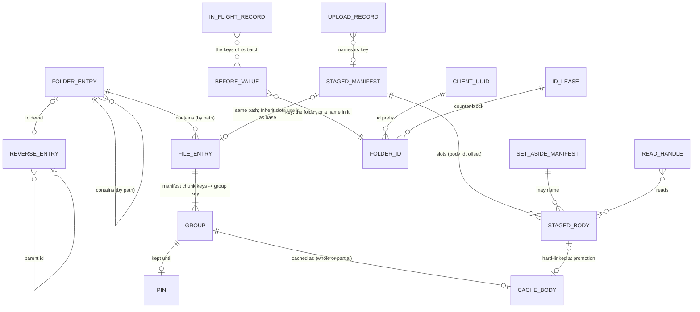

# Data model — local state of one client for one domain

The abstract model of what one machine keeps for one domain: every entity, whether it is
authoritative or rebuildable, the invariants between entities, and **what the domain owner
owns** (P1, with [07](../07-daemon-cli.md), which owns the process model and the ownership
lock). Sections 1–8 name no file or encoding; the byte formats are in
[04](../04-checkout-cache.md) §2, and §9 maps each entity to its format.

An encoding that keeps these entities, identities, invariants and write rules is correct,
whether it stores them in a filesystem tree, an embedded database or a key-value store.

## 1. Purpose and medium

The backend holds content-addressed chunks, a numbered log of committed changes and the
per-object tree projected from it, and may be unreachable. The local state exists to:

1. answer every namespace question (list, stat, lookup) without the network;
2. serve file bytes lazily within a bounded disk budget;
3. hold the user's unpublished edits, the only copy of that data until committed;
4. hold, for every key changed here and not yet committed, the main's value at that key, so the
   pending change and its guard can always be derived;
5. merge the main's changes into the local tree, and feed every change of the local tree to
   frontends as an ordered feed.

The medium's required properties (atomic rename, fsync of files and directories, create-if-
absent, advisory locks that die with their holder, sparse files, settable mtimes, optional hard
links) are listed in [durable-queue](../algorithms/durable-queue.md) §2. Every multi-object
change is an ordered sequence of single-object steps; there are no transactions and no
reference counts.

## 2. The owner

On one machine, exactly one process at a time owns a domain's local state: it holds the domain's
ownership lock ([07](../07-daemon-cli.md) §2.3) for as long as it touches that state.

**The owner owns, for its domain**, every entity of §3 except the machine-wide identity (§3.12):
the namespace mirror, the folder-id index, the chunk cache (bodies and pins), the staged tree,
the sync state (before-values, position, in-flight and arrival records), the upload records and
local intents, the deferred job logs, the applied log, the resync generation, the pause flag, the
export records, the kept walk and the scratch area, and all the in-memory state of §3.13.

- Only the owner creates, changes or removes any of it.
- Within the owner, every check-then-act is serialised per domain for metadata and per key for
  content ([04](../04-checkout-cache.md) §3.2).
- The owner runs everything that consumes owned state: recovery, the cycle (fetch, merge, push,
  projection), the upload queue, the deferred job logs, maintenance and every local recovery step
  ([04](../04-checkout-cache.md) §4.10).

**What other processes may do**:
- read owned objects that the owner replaces atomically (mirror entries, markers, pins), for
  advisory answers only, tolerating any object changing or vanishing between two reads, and
  never writing anything based on what they read;
- submit a new record to one of the domain's logs
  ([durable-queue](../algorithms/durable-queue.md) §4.2);
- as an export command, create and lock its own export records (§3.10);
- nothing else. A process that needs more asks the owner, or takes ownership when there is none.

**Machine-wide identity** (§3.12) is shared by every owner on the machine and arbitrated by
create-if-absent, never by the ownership lock.

**The ownership lock** is a file per domain with an advisory holder record naming the owner, and
the **pause flag** a file per domain whose presence means paused; both are specified by
[07](../07-daemon-cli.md) §2.3, §2.6 and §2.7.

**Host-owned state** lives outside the owner's domain state and outside this model: a host MAY
keep state of its own that feeds the owner through its request interface, and it is responsible
for that state's durability. On Android these are the ingest intents with their staging copies,
and the camera-backup records ([android-app](../frontends/android-app.md) §8 and §11). Once the owner has
acknowledged a handover, the content is in the staged tree and the host's copy is disposable.

## 3. Entities

Each entity gives: **Id** (what makes two instances the same), **Attr**, **Mut** (immutable,
replaced whole, appended, or written in place), **Life** and **Class** (§6).

### 3.1 Namespace mirror

With the staged edits of §3.5 laid over it, the mirror is the **local tree** $L$
([publication](../algorithms/publication.md) §3.2): what every frontend sees.

- **Folder entry.** Id: the logical path. Attr: the real leaf; the folder id (absent only for a
  folder whose local marker is unreadable, until an arrival by state). Operations under a folder
  with no id are UNPREPARED.
- **File entry.** Id: the logical path. Attr: a manifest, with its recorded name set to the
  entry's leaf. For a path with no staged edit it is the file's local value. For a path with a
  staged edit it is the edit's **base**: the manifest the edit's inherited chunks are read from.
  An undecodable entry is CORRUPT for its path and skipped by listings.
- **File id.** Attr of a file entry: its local file id ([01 §2.7](../01-core.md#27-item-references)).
  It moves with the entry on a local rename, on a move aside and on a move the main made
  ([conflict-resolution](../algorithms/conflict-resolution.md) §4.1), survives every replacement of the
  entry at the same path (a new version, a merge, an arrival by state), and goes with the entry's
  removal. It is minted when an entry is first written at a path that has none (a local create, a
  merge, a pull). Owner start gives one to every entry found without one, before any request is
  served ([04 §4.10](../04-checkout-cache.md#410-owner-start-local-recovery)). Naming an entry never
  writes: a `stat` or a listing reads ids and mints none.
- **Name record.** Id: the folder entry. Attr: the real leaf of a folder whose local name had to
  be escaped.
- Mut: entries are replaced whole; the tree changes by create, move and remove.
- Life: written by local namespace operations, merges, lazy pulls, promotion and revert; removed
  by local delete and rmdir, merges and the lazy prune.
- Class: **authoritative where a before-value exists** for the key (the value is this client's
  unpublished change); otherwise a projection of the main's tree at the position.

### 3.2 Folder-id index

- **Forward** (path → id): the folder entry's id. It is never minted by a read.
- **Reverse entry.** Id: the folder id. Attr: parent folder id, leaf. A resolution climbs to the
  root, stops on a cycle, and is accepted only if the path it produced maps forward to the same
  id.
- **Removed-id record.** Id: a logical path. Attr: the last folder id at that path. It outlives
  the folder so the change feed can still name an item under a folder that moved or went.
- Mut: replaced whole.
- Class: the reverse index is a projection (rebuilt by walking the mirror); removed-id records
  are history, kept for `REMOVED_ID_RETENTION` ([04](../04-checkout-cache.md) §4.9).

### 3.3 Chunk cache

- **Group**: a run of `per` consecutive chunks of one manifest, `per` derived from that
  manifest's chunk size. Id: a digest of the ordered member chunk keys (two files with the same
  run share a body).
- **Whole body.** Id: the group key. Attr: the group's bytes, verified. Its existence means
  whole.
- **Partial body.** Id: the group key. Attr: sparse bytes; which intervals it holds is known
  only to the owner's memory. It does not survive the owner.
- **Residency** (derived): online-only, cached or pinned
  ([04](../04-checkout-cache.md) §3.6).
- Mut: a whole body appears atomically and is replaced only by a forced refetch; a partial body
  is written in place.
- Life: created by reads, prefetch, materialisation and promotion; removed by the cap, evict,
  forget, and (partial bodies) owner start. Removal is reference-blind.
- Class: projection of backend chunks. Any of it may be removed at any time by the owner.

### 3.4 Pins

- Id: the group key: a pin is attached to content, follows it across renames and is shared by
  every file using the body. Attr: a deadline. A pin may exist before its body does.
- Mut: replaced (a re-pin moves the deadline).
- Life: created by pin requests before their fetch; removed by unpin, evict, forget, and by the
  cap once lapsed.
- Class: user intent, acknowledged durably; losing one costs a refetch and a silent loss of the
  offline guarantee, so it is written durably.

### 3.5 Staged edits

- **Staged manifest.** Id: the logical path (same tree shape as the mirror). It wins over the
  mirror entry of the same path in listings and reads, and is listed even if never published.
  Attr: real name, authoritative size, mtime, chunk size; either a whole-body reference or one
  slot per chunk (Inherit, Zero, Staged(body, offset)); state **Owed**, or **Uploaded** with the
  manifest the upload produced. Every local mutation produces Owed.
- **Staged body.** Id: an opaque random id. Attr: bytes in one group's layout (sparse), or a
  whole file. A group body may be written in place only while it is not also a cache body; a
  whole body is never written in place.
- **Set-aside manifest.** A staged manifest that could not be decoded. Kept under a name no
  reader lists, never decoded, never deleted automatically, reported; it keeps every body it
  may name alive.
- Mut: manifests replaced whole; group bodies written in place, grown and resized.
- Life: a manifest is created by the first write, truncate, create or handover; moved by
  renames and moves aside; removed by promotion after its commit, delete, create, revert, a
  replacing rename, or a recursive rmdir. A body is released when no manifest, set-aside manifest
  or open read handle names it, after the switch away from it is durable.
- Class: **authoritative, the sole copy of user data** until the entry that carries its manifest
  exists on the main.

### 3.6 Sync state

What the client knows of the main, and what it is in the middle of
([publication](../algorithms/publication.md) §3.2; formats: [03](../03-journal-sync.md) §2.7–2.8).

- **Before-value.** Id: a key (a folder id, or a folder id and a leaf name). Attr: the main's
  value at that key as this client last knew it: a content identity or ∅ for a file, a place or ∅
  for a folder. It exists exactly for the keys where the local tree differs from that knowledge.
  The pending set is read off these records; no operation is recorded.
- **Position.** The number of the last log entry merged.
- **Mirror id.** A random id written in the mirror's root and beside the position. They differ, or
  one is missing, when the mirror was lost or replaced apart from the sync state
  ([publication](../algorithms/publication.md) §4.8).
- **In-flight record.** The number and exact bytes of an entry being created.
- **Arrival record.** The result of a merge being enacted.
- **Set-aside record**: an undecodable record of any of these, kept and reported like a set-aside
  manifest.
- Mut: replaced whole; a before-value is created before the local tree changes at its key and
  removed when the key's value is committed or returns to it.
- Class: **authoritative, the sole record of what this client owes the main and of what it may
  assume about it.** A lost position costs an arrival by state. A lost before-value makes its key
  look clean: a local change there is then taken for the main's and overwritten by the next
  arrival, which is why before-values are written durably.

### 3.6a Upload records and local intents

- **Upload record.** Id: a record of the upload queue's log, naming a file key. Life: created at
  close, at a handover, and by the adoption of an unrecorded staged edit; removed when the edit is
  Uploaded or gone.
- **Local intent.** Id: a record naming one namespace operation whose local steps are in
  progress. Life: created before the first step, removed after the last; owner start completes
  what it finds.
- Class: authoritative for local recovery; neither is published.

### 3.7 Deferred job logs

- Id: one log per (domain, replica or backfill target); one record per job.
- Attr: a bodyless job (put, copy, delete of backend keys) that brings the target's key to the
  source's current state ([replication](../algorithms/replication.md)).
- Life: created by the owner or submitted by a non-owner writer before the main write is
  acknowledged; run and removed by the owner; parked on a non-retryable failure and retried.
- Class: **authoritative, the sole record of owed replication.**

### 3.8 Applied log

Every change made to this client's local tree, in the order made: its own operations and the
changes its arrivals brought. It is the change feed. Format and retention:
[03](../03-journal-sync.md) §2.9.

- Id of a line: its feed key.
- Mut: append-only.
- Class: history for the feed; not rebuildable. Loss makes outstanding anchors stale, and their
  consumer re-lists.

### 3.9 Resync generation, pause flag, feed watermark

- **Resync generation**: an opaque token carried by change-feed anchors; an anchor of another
  generation reads as stale ([07](../07-daemon-cli.md)).
- **Pause flag** ([07](../07-daemon-cli.md) §2.6).
- **Feed watermark**: the line of the oldest anchor a change-feed consumer may still present, and
  when it last moved ([08 §3.6](../08-frontends.md#36-change-feed-changes_since)). Absent: no
  consumer holds an anchor.
- **Dropped-shard record**: whether the applied log has ever dropped a shard, so an anchor naming
  no entry can be judged ([08 §3.6](../08-frontends.md#36-change-feed-changes_since)).
- Mut: replaced whole, durably. Class: authoritative bookkeeping; loss costs a re-list or a lost
  pause, never data. A lost watermark or dropped-shard record reads as absent and as "dropped".

### 3.10 Export records

Resume records of in-progress exports ([05](../05-ops-config.md) §4.4). Authoritative only about
the destination's progress; loss costs a re-export. The export command, which need not be the
owner, holds an exclusive lock on each record it uses for its whole run; the owner's sweep removes
only unlocked records older than its grace. This is the one domain-local object a non-owner
writes besides submissions.

### 3.11 Kept walk, scratch, temporaries

- **Kept walk**: the paging snapshot of a whole-domain listing ([07](../07-daemon-cli.md)).
- **Frontend scratch**: files a frontend holds beside the namespace and never publishes.
- **Temporary objects**: the write-aside half of every replacement ([01](../01-core.md) §2.9).
- All disposable; scratch and the kept walk are wiped by `full_resync` ([08](../08-frontends.md)).

### 3.12 Machine-wide identity

- **Client uuid**: one per data directory, shared by all domains; created once by durable
  create-if-absent (the loser adopts the winner's); immutable. Losing it would make this machine
  a new client, to which an entry it had in flight reads as a peer's.
- **Folder-id lease**: a block of counter values one process may mint folder ids from; created
  by durable create-if-absent before its first id is used ([03](../03-journal-sync.md) §2.1).
  Leases MUST never let a block be leased twice.
- Class: authoritative.

### 3.13 In the owner's memory

One instance per domain per owner, shared by every consumer in the owner: the metadata and key
locks and edit generations ([04](../04-checkout-cache.md) §3.2); read handles
([04](../04-checkout-cache.md) §3.3); the cache's body locks,
generations, held intervals, in-flight table and counts
([read-path-and-cache](../algorithms/read-path-and-cache.md) §3.2); the queues' loaded records
and slots ([durable-queue](../algorithms/durable-queue.md) §3.1); the cycle state, the projection
watch and the cursor debouncer ([publication](../algorithms/publication.md) §3.3). All are rebuilt
from durable state at owner start. Retentions of open-and-unlinked content
([04](../04-checkout-cache.md) §3.3) are among the read handles.

## 4. Relations

| Reference | By | A dangling reference means |
|---|---|---|
| file entry → group | content | not cached: fetch on demand |
| pin → body | content | a pin placed before its fetch, or whose body was evicted after it lapsed; inert |
| staged slot → staged body | body id | cannot happen by §5.2; if found, CORRUPT: the edit is kept, reported, and its upload parked, never abandoned |
| staged Inherit slot → base entry | path | CORRUPT; zeros are never served as content |
| staged manifest → upload record | key | the file is open, or a crash fell before close: owner start adopts it |
| upload record → staged manifest | key | nothing staged: the record is completed |
| before-value → key | folder id (and leaf) | the folder is gone locally: the key's local value is ∅, and the command is a removal |
| folder id → path | reverse chain | unresolvable until rebuild; operations refuse rather than guess |
| change-feed anchor → applied line | generation and feed key | pruned or another generation: the reader re-lists |
| deferred job → backend key | key | the job re-derives from the source's current state |

## 5. Invariants

### 5.1 At rest

1. **A whole-body name means whole and verified.** Partial bodies never survive their owner.
2. **Held intervals never exceed the disk**
   ([read-path-and-cache](../algorithms/read-path-and-cache.md) I1).
3. **Staged is unreachable by projection maintenance**: the cap, evict, an arrival by state and the lazy
   prune never address the staged tree, by separation of stores.
4. **Every body a staged manifest names exists**, up to the bytes it holds.
5. **Uploaded means on the main**: an Uploaded manifest names only chunks the main held when the
   upload ended. A collection may remove them before the commit; the commit's gate finds out.
6. **Nothing owed is unrecorded**: every key where the local tree differs from what this client
   knows of the main has a before-value, or is a staged edit with none, which owner start gives
   one from its base. A before-value precedes the local change at its key.
7. **The staged bytes outlive their commit**: a staged edit is promoted only after the entry
   carrying its manifest exists.
8. **Folder ids are final and unique**: a folder holds at most one id, nothing replaces it, ids
   are unique across clients (uuid prefix) and processes (leases).
9. **The reverse index is verified before use.**
9a. **File ids are unique and stable**: on a full tree every file entry has one file id, no two
    entries share one, and an id is never given to another file.
10. **Mirror completeness** (full tree): absence in the local tree is absence in the domain, as of
    the position, except where a before-value says this client removed the item.
11. **The position moves only by a merge or by this client's own commit.**
12. **A feed line means done**: a line exists only after the change it names is durable.
13. **Nothing authoritative is ever discarded because it could not be decoded**: it is set
    aside, with everything it may reference.

### 5.2 Durability order

Every authoritative write obeys [durable-queue](../algorithms/durable-queue.md) §3 (R1–R6). The
local referent → referrer pairs it governs:

| Referent (durable first) | Referrer |
|---|---|
| staged bodies | the staged manifest naming them |
| the before-value of a key | the change of the local tree at that key |
| the staged manifest (at sync and close) | the upload record |
| the chunks on the main | the Uploaded staged manifest |
| the in-flight record | the request that creates the entry |
| the log entry on the main | the drop of its before-values, then the promotion of its staged edits |
| cache groups and the mirror entry of a promotion | the release of the staged manifest, then of its bodies |
| a local intent | the first local step of its operation |
| the arrival record | the first change a merge makes to the local tree |
| a change of the local tree | its feed line |
| a lease | the first folder id minted from it |

### 5.3 Temporarily violated

| Invariant or state | During | Repaired by |
|---|---|---|
| mirror completeness | always on a lazy tree | the next pull of that folder |
| folder-index consistency | a reparent; a crash in one | verification on read; rebuild |
| unrecorded staged edit | first write → close; a crash before close | owner start adoption |
| a before-value equal to the local value | a crash between the record and the change | dropped at owner start |
| a namespace operation half done | a crash inside it | its local intent, at owner start |
| a merge half enacted | a crash inside it | the arrival record, at owner start |
| in-flight record with unknown outcome | a crash or a lost answer during a push | the next cycle issues the same create again ([publication](../algorithms/publication.md) §4.8) |
| unnamed staged body | a crash between a body's creation and the manifest naming it; a deferred release | the owner-start sweep ([04](../04-checkout-cache.md) §4.10) |
| committed staged edit not promoted | a crash after a push's `Won` step | owner start promotes it |
| temporary object | a crash mid-replace | the temporary sweep |
| partial body | always, while its owner runs | removed at owner start |

## 6. Authoritative or derived

| Entity | Class | Rebuilt from |
|---|---|---|
| staged manifests, staged bodies, set-aside manifests | **authoritative: sole copy of user data** | never |
| before-values, position, in-flight and arrival records, set-aside records | **authoritative: sole record of what is owed and of what is known of the main** | never; a lost position is replaced by an arrival by state |
| upload records, local intents | authoritative for recovery | an unrecorded staged edit is re-derived (adoption) |
| deferred job logs | **authoritative: sole record of owed replication** | never |
| client uuid, leases | **authoritative identity** | never |
| pins | authoritative user intent | re-pin |
| applied log | history | not rebuildable; loss makes anchors stale |
| resync generation, pause flag, feed watermark, dropped-shard record | authoritative bookkeeping | loss causes a re-list, a lost pause |
| file ids | authoritative, local only | not rebuildable; loss re-identifies the files to hosts that persist identifiers (they are re-fetched once) |
| export records | authoritative about the destination only | re-export |
| folder ids in the mirror | authoritative: final from the mint | an arrival by state |
| namespace mirror | authoritative at keys with a before-value; elsewhere a projection of the main's tree | an arrival by state (full); pulls (lazy) |
| removed-id records | history | not rebuildable; loss makes some feed ops unnameable |
| reverse folder index | projection of the mirror | rebuild |
| chunk cache | projection of backend chunks | any read |
| kept walk, scratch, temporaries, spools | disposable | nothing |

## 7. Full and lazy trees

The two trees differ in what the mirror promises, not in their entities.

- **Full** (desktop hosts): the mirror is complete; the owner's cycle keeps it current; an arrival
  by state rewrites it against the main's tree.
- **Lazy** (Android): the mirror holds the folders the user has opened; absence means "not
  fetched". Sync state covers those folders only: a key in a folder never pulled has no local
  value and no before-value, and an entry's command on it is skipped. The folders held are kept
  current by pulls and by the arrivals that precede each push
  ([04](../04-checkout-cache.md) §3.5, [android](../frontends/android.md) §3.2); a pull merges the
  folder with the pending commands on it and never drops them, and a pull that cannot read every
  child changes nothing. There is no background cycle. Staged edits, before-values, identity and
  deferred logs are exactly as on the full tree, and the app is their owner, resuming them at
  every start. Hard links may be unsupported, so promotion may copy.

## 8. Growth and reclamation

| Grows with | Bound, reclaimer |
|---|---|
| chunk cache: reads, prefetch, promotion | the cap by coldest mtime, excluding pinned bytes; after uploads and periodically. No cap configured: unbounded by the user's choice |
| partial bodies | removed at owner start; counted by the cap meanwhile |
| pins | lapsed pins removed by the cap walk |
| staged edits | commit and promotion; unnamed bodies by the owner-start sweep |
| set-aside manifests and records | reported; removed only by an explicit user request |
| before-values, deferred logs | commits and discharge; they grow with pending work while offline, by design |
| parked records | retried; reported until they succeed |
| applied log | age, held back by the feed watermark until it lapses ([03](../03-journal-sync.md) §2.9) |
| removed-id records | retention of [04](../04-checkout-cache.md) §4.9 |
| id leases | [03](../03-journal-sync.md) §2.1 (never reusing a block) |
| export records | deleted on completion; age sweep ([05](../05-ops-config.md)) |
| temporaries | the temporary sweep |
| scratch, kept walk | one walk per domain |
| conflicted copies | user-visible files; never reclaimed automatically |
| in-memory state | rebuilt at owner start; handles and retentions bounded by the frontends' open files |

## 9. Encoding

Every optional field and optional file has a stated meaning when absent
([04](../04-checkout-cache.md) §2); no operation requires rewriting a valid existing file.

| Entity | Specified in |
|---|---|
| mirror entries, folder, name and file-id markers | [04](../04-checkout-cache.md) §2.3 |
| reverse entries, removed-id records | [04](../04-checkout-cache.md) §2.4 |
| staged manifests, set-aside names | [04](../04-checkout-cache.md) §2.5 |
| staged bodies | [04](../04-checkout-cache.md) §2.6 |
| cache bodies, partial bodies, pins | [04](../04-checkout-cache.md) §2.7 |
| upload records, local intents | [04](../04-checkout-cache.md) §2.8 |
| queue log layout, record names, submissions | [durable-queue](../algorithms/durable-queue.md) §4.1–§4.2 |
| before-values, position, in-flight and arrival records | [03](../03-journal-sync.md) §2.7–2.8 |
| applied log, feed keys, client uuid, leases | [03](../03-journal-sync.md) |
| deferred job bodies | [06](../06-backends.md) |
| export records, spools | [05](../05-ops-config.md) |
| ownership lock, pause flag, resync generation, feed watermark, dropped-shard record, kept walk | [07](../07-daemon-cli.md) |
| temporary names, leaf escaping | [01](../01-core.md) |

## 10. Conformance

An implementation MUST exhibit the following model-level properties; the operation-level ones
are in [04](../04-checkout-cache.md) §6 and
[read-path-and-cache](../algorithms/read-path-and-cache.md) §8.

- Removing the whole chunk cache, running the cap at 0, an arrival by state and a lazy prune leave
  every staged edit and set-aside manifest, with its bodies, intact.
- A second process never writes the domain's local state while an owner holds the lock, other
  than submissions and export records; its reads never observe a torn object.
- After any crash, owner start leaves no partial body, no unnamed staged body, no local intent, no
  arrival record, no before-value equal to the local value, and no staged edit without a
  before-value and an upload record.
- A local operation never changes what the client knows of the main: after any sequence of local
  operations and crashes, the local tree with the before-values put back equals the main's tree at
  the client's position.
